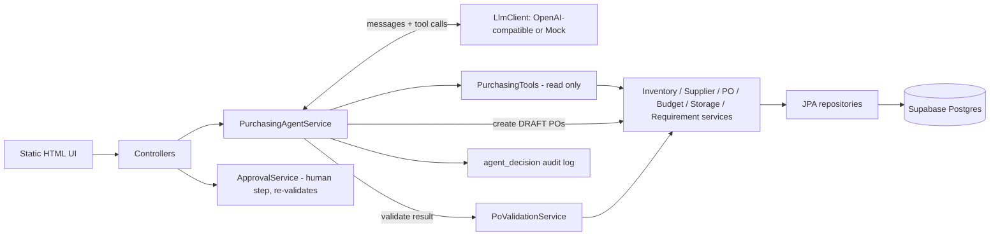
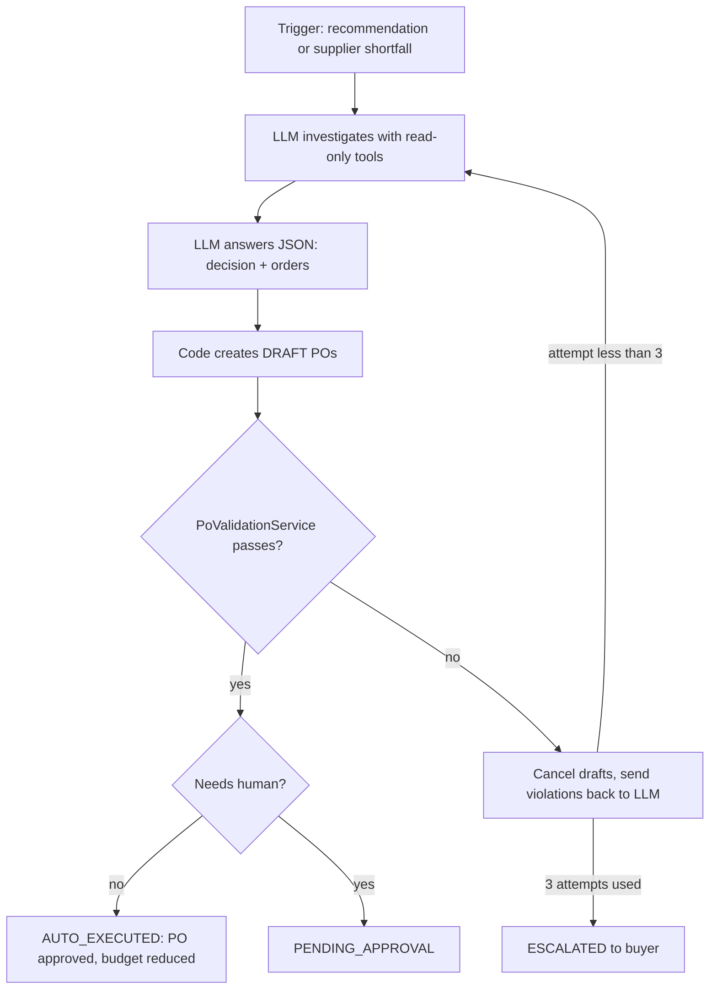
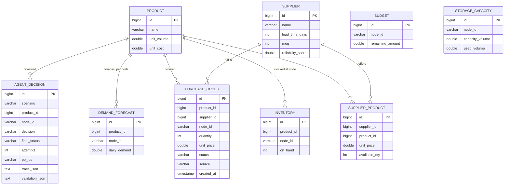
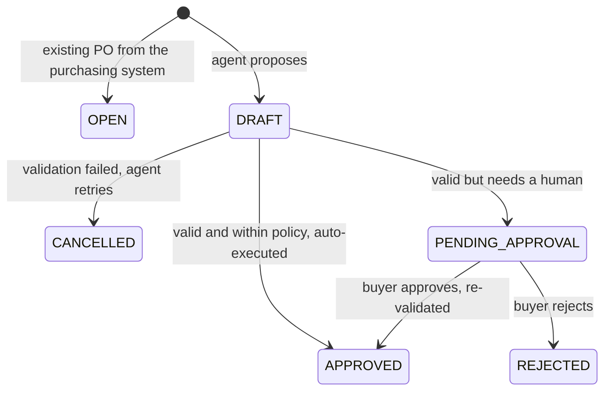

# AI Purchasing Agent

A full-stack agent that reviews purchasing situations, **investigates with tools, decides, acts, and then validates its own result**. If the result is not acceptable it corrects itself, and if it still cannot, it escalates to a human.

Stack: Spring Boot 3 (Java 17+), Spring Data JPA, Supabase Postgres (or in-memory H2), plain HTML/JS UI, any OpenAI-compatible LLM with tool calling (plus a deterministic mock LLM).

## Scenarios covered

| Scenario | How it is handled |
|---|---|
| **1. Recommendation review** (accept / modify / reject / investigate) | End to end |
| **2. Supplier cannot fulfil** (ordered 500, supplier gives 250) | End to end: PO is shrunk, agent re-sources the gap from an alternate supplier |
| **4. Purchasing constraint** (budget, storage, MOQ, no supply) | End to end: agent buys what is allowed and escalates the remainder, or escalates entirely |
| 3. Demand changed | Not built. Extension: add a `get_sales_trend` tool and a `DEMAND_CHANGE` trigger; the loop and validator stay the same |

## Architecture



Layers: `entity -> repository -> service -> controller`, plus `agent` (LLM loop, tools) and `eval`.

### The agent loop (the core idea)



## Approach and key design decisions

1. **The recommendation is treated as a hypothesis.** The prompt tells the agent to verify it. The agent calls tools for inventory, forecast, open POs, supplier terms, alternates, budget, storage.
2. **No LLM arithmetic.** `calculate_requirement` does the replenishment math: `target = daily demand x (lead time + 7 review days + 2 safety days)`, `net need = target - on hand - incoming committed POs`. The LLM decides what to do with the numbers.
3. **The LLM cannot write.** Tools are read-only (plus a dry-run `validate_proposal`). The LLM returns a decision; our code creates the DRAFT PO. So every write is gated by validation, and the set of allowed actions is explicit code.
4. **Independent validation (the feedback loop).** `PoValidationService` is plain Java and re-reads database state after the draft POs exist. It does not trust the LLM's reasoning.
5. **Self-correction, then escalation.** Violations are sent back to the LLM as a `VALIDATION FAILED` message (max 3 attempts). After that, nothing is executed and the case is `ESCALATED`.
6. **Human approval rules.** A PO waits in `PENDING_APPROVAL` if any of these hold: the agent flagged it, it only partly covers the need (constraint-limited), or its value exceeds the auto-approval limit (50,000). Approval **re-validates**, because the world may have changed, and returns HTTP 409 if the PO is no longer valid.
7. **Auditability.** Every run stores decision, reasoning, full tool trace, and validation report in `agent_decision`, and the UI shows the trace.

### Validation checks

| Check | Rule |
|---|---|
| `QUANTITY_POSITIVE`, `MOQ` | Order quantity must be at least the supplier's MOQ |
| `SUPPLIER_AVAILABILITY` | Quantity must not exceed what the supplier can currently supply |
| `BUDGET` | Order cost must not exceed the node's remaining budget |
| `STORAGE` | Volume must fit free space (capacity - stored - incoming of all products) |
| `STOCKOUT` | on hand + incoming + new must cover demand during the lead time (this also validates **REJECT** decisions) |
| `OVERSTOCK` | projected stock must not exceed 21 days of demand |
| `POLICY_COVER` (advisory warning, never blocks) | projected stock below `demand x (lead + 7 review + 2 safety days)`, the same horizon `calculate_requirement` plans for |

#### Two coverage horizons (why `STOCKOUT` is lead-time only)

- **Planning horizon** (`calculate_requirement`): `target = daily x (lead + 7 + 2)`, `net need = target - on hand - incoming`. It tells the agent how much to order.
- **Hard guard** (`STOCKOUT`): `on hand + incoming + new >= daily x lead`. It means the projected balance is not negative when the new order lands. It stays lead-time only on purpose: budget- or storage-limited partial buys must still be allowed (the agent buys what it can and escalates), and a 12-day hard bar would reject exactly those plans.
- **Advisory** (`POLICY_COVER`): reports when the plan ends below the planning horizon. Partial coverage is already routed to human approval, and the warning is stored in the validation report and the audit trace.

Example (milk, 40 on hand, 300 incoming, 70/day, supplier lead time 5 days, new order 460): cover = 800. `STOCKOUT` passes (800 >= 350), `POLICY_COVER` warns (800 < 980). See `PoValidationServiceTest`.

## Data model (Supabase / Postgres)

`product`, `inventory`, `demand_forecast`, `supplier`, `supplier_product` (price, available qty), `purchase_order` (OPEN / DRAFT / PENDING_APPROVAL / APPROVED / REJECTED / CANCELLED), `budget` (per node), `storage_capacity` (per node), `agent_decision` (audit). DDL: `src/main/resources/schema.sql`, seed: `data.sql`. Three nodes: `BLR-01` (healthy), `BLR-02` (tight budget), `BLR-03` (tight storage).

### Database diagram

Relationships are logical (joined by `product_id`, `supplier_id`, `node_id`); the schema has no foreign key constraints so the demo data can be reset easily. `node_id` (for example `BLR-01`) links the per-node tables.



Which table answers which agent question:

| Question | Tables |
|---|---|
| How much stock do we have and need? | `inventory`, `demand_forecast`, committed `purchase_order` rows (OPEN, APPROVED) |
| Who can supply, how fast, how much? | `supplier`, `supplier_product` |
| Can we afford and store it? | `budget`, `storage_capacity` (plus incoming volume from `purchase_order`) |
| What did the agent do and why? | `agent_decision` (trace and validation report), `purchase_order` (DRAFT, PENDING_APPROVAL, APPROVED, CANCELLED) |

Purchase order lifecycle:



## Setup and run

Requirements: JDK 17+ and Maven.

```bash
cp .env.example .env        # optional; defaults run fully local with the mock LLM
mvn spring-boot:run
# open http://localhost:8080
```

- **No config needed**: runs on in-memory H2 with the mock LLM.
- **Supabase**: create a project, set `SUPABASE_DB_URL` (JDBC string from Project Settings -> Database, session pooler), `SUPABASE_DB_USER`, `SUPABASE_DB_PASSWORD` in `.env`. Startup runs `schema.sql` + `data.sql` (it drops and recreates the tables, which is the demo reset).
- **Real LLM**: set `LLM_PROVIDER=openai`, `LLM_API_KEY`, optionally `LLM_BASE_URL` and `LLM_MODEL` (any OpenAI-compatible endpoint with tool calling).
- **Mock LLM**: `LLM_PROVIDER=mock` is a scripted policy that calls the same tools. `LLM_MOCK_NAIVE_FIRST=true` makes its first answer blindly accept the recommendation, to show the feedback loop live.

Tests: `mvn test` (uses the mock LLM, needs no key).

### Troubleshooting connections

- **Supabase: use the session pooler, not the direct host.** The "Direct connection" string (`db.<project-ref>.supabase.co`) is IPv6-only and will fail to resolve on IPv4-only networks (most home/office Wi-Fi). Copy the **Session pooler** JDBC string instead (`jdbc:postgresql://aws-0-<region>.pooler.supabase.com:5432/postgres`) and use the pooler username `postgres.<project-ref>`. The region in the pooler host must match where your project lives (find it in the Supabase dashboard URL / connection dialog).
- **Build fails with many `cannot find symbol` errors (getters):** this happens when compiling with a JDK newer than the Lombok version bundled by Spring Boot (e.g. JDK 24 with Lombok 1.18.34). Run the build with JDK 17, which the project targets:
  ```bash
  export JAVA_HOME=$(/usr/libexec/java_home -v 17)
  mvn clean compile
  ```

### Using the demo UI

1. Pick a situation, click **Run agent**. You see the decision, reasoning, final validation table and the full tool trace.
2. Situations that need a human appear under **Waiting for human approval**: Approve (re-validates) or Reject.
3. **Custom request**: the always-visible "Run a scenario manually (custom request)" card lets you pick any product, node, supplier and quantity (or an open PO and the quantity the supplier can ship) and run the agent on it. To change the starting world (stock, demand, supplier stock, budget), edit `data.sql` or the Supabase rows first.
4. **Reset demo data** restores the seed state. **Run evaluation** runs all scenarios and scores them.

REST API: `GET /api/scenarios`, `POST /api/agent/run`, `GET /api/agent/decisions`, `GET /api/purchase-orders?status=`, `POST /api/purchase-orders/{id}/approve|reject`, `POST /api/admin/reset`, `POST /api/eval/run`.

## Evaluation approach

`EvaluationService` resets the data, runs each preset, and scores the result against **hand-computed ground truth** (`ScenarioCatalog`, math below). Criteria map to the assignment questions:

| Criterion | Question answered |
|---|---|
| `decision_correct` | Was the decision correct? |
| `information_gathered` | Did it call the tools needed for this case (e.g. open POs, budget, alternates)? |
| `constraints_respected` | Is the quantity within the correct range and no forbidden supplier used? |
| `action_correct` | Did the final status match (auto-executed / pending approval / no action / escalated)? |
| `result_validated` | Did the validator pass on the final state? |
| `attempts` (reported) | More than 1 means the first action failed and the loop corrected it |

Scenarios (seed data in `data.sql`; policy: target = demand x (lead + 7 + 2)):

| Id | Situation | Ground truth |
|---|---|---|
| `s1-accept` | Milk, 70/day, 40 on hand, rec 800 | need = 70x12-40 = 800 -> ACCEPT, auto-executed (40k) |
| `s1-overstock` | Rice, 20/day, 600 on hand, rec 800 | need 0 -> REJECT, no action |
| `s1-open-po` | Oil, 200 on hand + 300 open PO, rec 800 | need = 50x12-200-300 = 100 -> MODIFY to 100 |
| `s4-budget` | Coffee, need 800 at 300 each, budget 90k | affords 300 -> MODIFY 300, pending approval (partial) |
| `s4-storage` | Detergent (volume 4), free storage 1400 | fits 350 -> MODIFY 350, pending approval |
| `s2-shortfall` | Eggs PO 500, supplier gives 250, supplier has no more | alternate supplier (not #1), about 290 units, pending approval |
| `s4-no-supply` | Ice cream, only supplier has 50 in stock with MOQ 100 | cannot order -> INVESTIGATE / escalated |

**What happens when the initial action does not work** is tested by the second test: `LLM_MOCK_NAIVE_FIRST` mode makes the agent blindly follow the recommendation on its first attempt. The validator must catch it (overstock, budget, storage, supplier stock, MOQ), the feedback loop must produce a corrected plan, and the final outcome must equal the smart run. Results of `mvn test`:

```
EVAL SMART: 7/7                         EVAL NAIVE-FIRST: 7/7
s1-accept     ACCEPT       attempts=1   s1-accept     ACCEPT       attempts=1
s1-overstock  REJECT       attempts=1   s1-overstock  REJECT       attempts=2  (overstock caught)
s1-open-po    MODIFY 100   attempts=1   s1-open-po    MODIFY 100   attempts=2
s4-budget     MODIFY 300   attempts=1   s4-budget     MODIFY 300   attempts=2  (budget caught)
s4-storage    MODIFY 350   attempts=1   s4-storage    MODIFY 350   attempts=2  (storage caught)
s2-shortfall  MODIFY 290   attempts=1   s2-shortfall  MODIFY 290   attempts=2  (supplier stock caught)
s4-no-supply  INVESTIGATE  attempts=1   s4-no-supply  INVESTIGATE  attempts=2
```

Important limitation, stated honestly: the mock LLM proves the **system** (tools, validator, loop, approval, eval) works and is deterministic. It does not measure LLM quality. Run **Run evaluation** with `LLM_PROVIDER=openai` to score a real model on the same ground truth; LLM runs are non-deterministic, so judge by pass rate over several runs.

## How the agent's decisions are validated (summary)

1. **Before the action**: the agent may dry-run `validate_proposal`.
2. **After the action**: the draft POs are written, then `PoValidationService` re-reads DB state and checks MOQ, supplier stock, budget, storage, stockout, overstock. A `REJECT` is validated too (rejecting must not cause a stockout).
3. **If it fails**: drafts are cancelled, the exact violations go back to the agent, and it retries (max 3), else escalates.
4. **At human approval**: validation runs again against the then-current state.
5. **Offline**: the evaluation harness compares outcomes to independently computed ground truth.

## Project layout

```
src/main/java/com/rappi/purchasing
  entity/ repository/ service/ controller/   standard layers
  agent/   PurchasingAgentService (loop), PurchasingTools, LlmClient, OpenAiLlmClient, MockLlmClient, AgentPrompts
  eval/    ScenarioCatalog (ground truth), EvaluationService
  dto/     small records
src/main/resources  schema.sql, data.sql, application.yml, static/index.html
src/test            EvaluationTest
```

## Known simplifications

Single product per request; one lead time per supplier; purchase orders have no arrival dates, so existing incoming stock is assumed to land within the lead time and all stock buckets are summed at once (no day-by-day simulation; adding an expected arrival date to `purchase_order` is the next step); budget is a single per-node balance; money uses `double`. These keep the code easy to explain and are the first things to harden for production.
